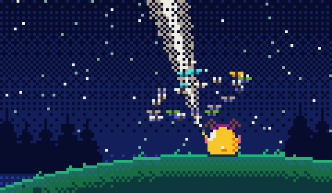
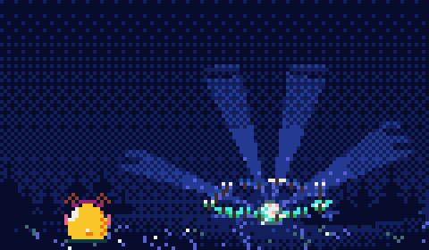
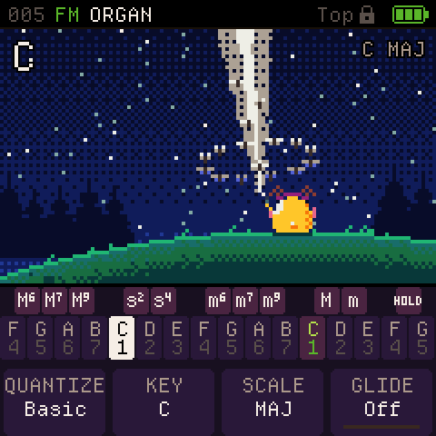
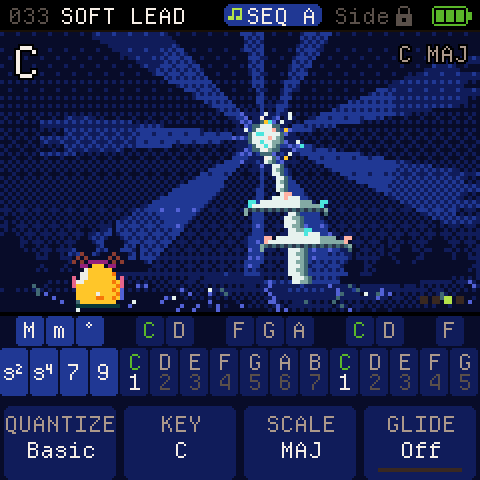

# Sornyak

> **Sornyak is a fork of [CoralFlower](https://github.com/FicusFicusov/CoralFlower)** by FicusFicusov. It keeps
> CoralFlower's instrument and replaces its plants with two night scenes that grow with your recording: the torch
> and the Sornyak.
> Everything else in this README is CoralFlower's work, described under the fork's name.

**Your M-VAVE FM-1, made for chords.** Sornyak is free firmware for the FM-1. Press a chord key, and every note
you play becomes a whole chord, with a bass underneath. While you play, a small moose on the screen listens.

Sornyak is inspired by the Telepathic Instruments Orchid. Its controls are redesigned for the FM-1's keys and
buttons, because every instrument is played differently.

Sornyak has no published release or installer site yet. Until it does, build it yourself (below); the browser
version and the installer of [CoralFlower's site](https://ficusficusov.github.io/CoralFlower/) run CoralFlower, not
Sornyak.

## What it does

- **Notes or chords.** The lower keys play the notes of a scale you choose. Press an upper key, and each note
  becomes a chord: major, minor, sus2 or sus4, plus major and minor 6, 7 and add9. Press two upper keys together to
  combine them. The chord stays on until you choose another one. The key marked Off turns chords off, and the keys
  play single notes, several at once. Choose from 27 scales, chromatic included, starting on any note. Chord glide (off by default) slides
  each note into the next chord.
- **Two layouts, each with a Lock mode.** In the Top layout, the upper row picks the chord type and the lower row the
  root. In the Side layout, a few keys on the left pick the type and the rest play roots. Lock mode keeps the chord
  type you tapped, so you don't have to hold its key. A new FM-1 starts in Top with Lock; without Lock, a chord
  plays only while you hold its key.
- **A bass part under your chords** (you can turn it off), with its own sound and range, plus an octaver that doubles each bass note.
- **An arpeggiator** with nine patterns, including a strum like the one on the Orchid chord synth. It locks to the
  metronome or to an external MIDI clock.
- **A sequencer** with eight patterns of chords, bass, drums and one more sound (the layer), and a song made of them.
  REC on the main screen records what you play into a new pattern, after a one-bar count-in.
- **Six effects** in an order you choose: filter, drive, chorus, phaser, delay and reverb.
- **About 60 sounds** from two synth engines, virtual analogue and FM: pads, keys, strings and basses. Many pads
  change slowly on their own. Chords and basses have separate lists. Every sound has an editor, and you can save your
  own.
- **The torch** (the Top layout). A small round yellow moose sits on a hill at night and shines a torch into the
  stars; the beam swings slowly and moths drift up it. Butterflies circle the moose: one ring, and one more for each
  track of the playing pattern that has something recorded. They flap and circle faster when the music is loud,
  and every note makes some of them flash.
- **The Sornyak** (the Side layout). A pale weed in tiers grows on a night meadow: one tier for each track of the
  playing pattern that has something recorded (Chords, Bass, Layer, Drums). Its light follows the sound: the rays and
  the halo breathe with the loudness, a strong chord flashes the sky, and every note lights a bud. With all four
  tracks recorded, the crown shines over the whole sky. A small round yellow moose with headphones sits in the grass
  and listens.
- **Live over a pattern.** While a pattern plays, HOME's keys and PRESETS play a sound of their own on the Layer, so
  the pattern's chords keep theirs; REC there records you into the pattern's Layer track.
- **MIDI over USB.** The chords, the bass and the sequencer's Layer and Drums go out on four channels you set. The
  FM-1 follows an external MIDI clock or sends its own.

<table>
  <tr>
    <td></td>
    <td></td>
    <td></td>
  </tr>
  <tr>
    <td></td>
    <td></td>
    <td></td>
  </tr>
</table>

## Install

Sornyak's installer is this repository's site (`web/`, published by `.github/workflows/pages.yml` once GitHub Pages
is turned on for the repository). It installs Sornyak over CoralFlower too, and keeps CoralFlower's backups working.
CoralFlower's own installer does not know Sornyak and refuses to update it.

1. Open Sornyak's installer page in **Chrome or Edge** on a computer. Only these browsers can talk
   to the FM-1 over USB.
2. Connect the FM-1 straight to the computer. Don't use a USB hub, and use a cable that carries data, not a
   charge-only one.
3. Press **Install on your FM-1**. Keep the page open and the cable in for about a minute. The FM-1 restarts as
   Sornyak.

If the FM-1 runs Sornyak, ChoralRoot or Felucca, the installer saves your sounds to a file first. The official firmware's sounds can't be backed up. To return to the stock firmware, download FM-1
V15 from [m-vave.com](https://www.m-vave.com) and install it from the same Sornyak page. Installing firmware is at
your own risk.

## Build it yourself

- **From a fresh clone.** Nothing generated is in git: every build first writes the fonts, icons, tables and samples
  into `build/gen/`, with Python 3, Pillow and fontTools. `python3 tools/build.py --gen-only` does that step alone, for
  any other way of building the firmware. On GitHub, the check workflow (`.github/workflows/check.yml`) builds a fresh
  clone on every push.
- **The emulator and the site.** Install the [Emscripten SDK](https://emscripten.org), then run
  `sh tools/emu/web/build_web.sh` and `sh tools/make_site.sh build/site`. The site lands in `build/site/`, with the
  emulator in `build/site/play/`.
- **The headless runner.** `sh tools/emu/cf_headless.sh SCRIPT` plays a script of key presses, takes screenshots and
  records audio. The tests use it.
- **The firmware package.** `./build.sh --release X.Y` needs the toolchain from JieLi, the maker of the FM-1's chip.
  The toolchain runs on Linux x86-64 only, and `tools/get_toolchain.sh` fetches it. On GitHub, the release workflow
  (`.github/workflows/release.yml`) builds the package for you.

## Credits and licence

Sornyak is a fork of [CoralFlower](https://github.com/FicusFicusov/CoralFlower) by FicusFicusov, which is a fork of
[ChoralRoot FM-1](https://github.com/Quixotic7/ChoralRootFM1) by Quixotic7, itself
a fork of [Felucca](https://github.com/hugelton/Felucca) by Leo Kuroshita (Hügelton Instruments). The FM engine comes
from [Melodee](https://github.com/keremimo/melodee) by Kerem Kilic, and the screens use
[Departure Mono](https://departuremono.com), a font by Helena Zhang. Thank you all.

Sornyak is free software under the GPL-3.0. `LICENSE` and `LICENSING.md` have the details.

M-VAVE and FM-1 are trademarks of their respective owners. Orchid is a product of Telepathic Instruments. Sornyak
is not affiliated with M-VAVE, Cuvave or Telepathic Instruments.

## Feedback and support

For Sornyak (the view, the live Layer, the rename), open an issue in this repository. For everything else, the
instrument is CoralFlower's: its author takes feedback through
[CoralFlower's issues](https://github.com/FicusFicusov/CoralFlower/issues), and the **Support** button on the site
sends donations to CoralFlower's author.
